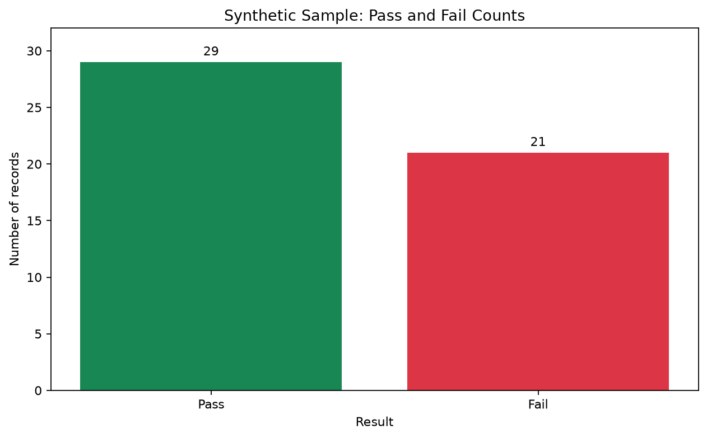

# Student Pass Predictor

A small Python project that classifies sample student scores as **Pass** or **Fail**, then creates a chart of the results.

The program uses a simple threshold rule: a score of 60 or higher is classified as Pass. This is an educational demonstration, not a trained machine-learning model or a tool for making real decisions about students.

## Preview



## What it does

- Reads the sample records from `record.csv`.
- Classifies each record using the 60-point pass mark.
- Saves the labeled records to `record_with_results.csv`.
- Creates a pass/fail bar chart in `screenshots/pass-fail-chart.png`.

## Requirements

- Python 3.10 or newer
- pandas
- matplotlib

## Run locally

1. Clone this repository and open its folder:

   ```bash
   git clone https://github.com/onitan-codes/student-score-predictor.git
   cd student-score-predictor
   ```

2. (Recommended) Create and activate a virtual environment:

   **Windows PowerShell**
   ```powershell
   py -m venv .venv
   .\.venv\Scripts\Activate.ps1
   ```

   **macOS / Linux**
   ```bash
   python3 -m venv .venv
   source .venv/bin/activate
   ```

3. Install dependencies and run the program:

   ```bash
   python -m pip install -r requirements.txt
   python project.py
   ```

## Project files

| File | Purpose |
| --- | --- |
| `project.py` | Applies the pass/fail rule and creates the chart. |
| `record.csv` | Clearly labeled synthetic sample data; contains no real student records. |
| `record_with_results.csv` | Generated output with updated classifications. |
| `requirements.txt` | Python package dependencies. |
| `screenshots/pass-fail-chart.png` | Preview chart generated by the program. |
| `student_pass_model.joblib` | Existing model artifact kept in the repository; the current script does not use it. |

## Data and privacy

The included rows are synthetic examples created for this repository. They do not represent real students and contain no names, contact details, student IDs, or other direct identifiers. Do not add real student information to this public repository.

## License

No license has been specified yet. Ask the repository owner before reusing this project.
